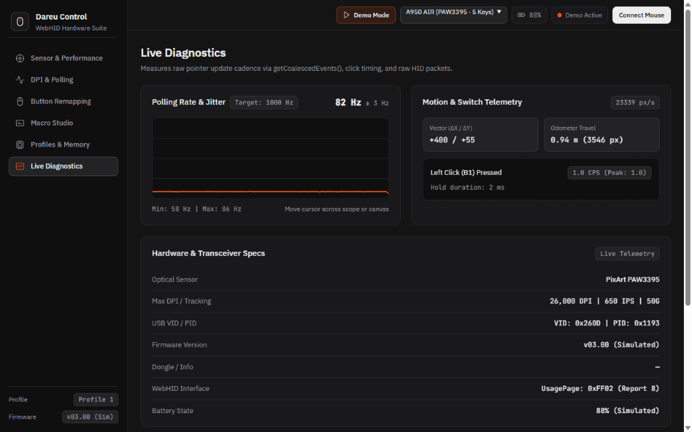
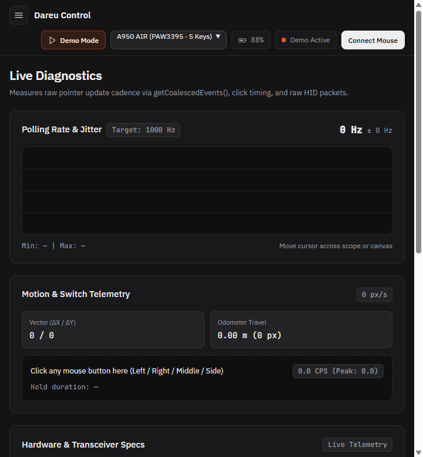

# Dareu Control — WebHID Hardware Suite

Browser-native **WebHID configurator, macro studio, NVRAM inspector, and live telemetry suite** for Dareu gaming mice — built as a zero-dependency vanilla ES module web application with full offline **Demo Mode** support.

**Live GitHub Pages App:** [https://jgsphaela.github.io/dareu-control/](https://jgsphaela.github.io/dareu-control/)

---

## Screenshots

| Desktop (`1440x900`) | Narrow / Tablet Drawer |
|---|---|
|  |  |

---

## Supported Hardware (`VID: 0x260D`)

Both **JM (JieLi 16-byte memory-mapped NVRAM, Report ID 8)** and **TG (Telink 64-byte Feature Report command-class)** architectures are supported:

| Model | PID | Protocol | Sensor | Max DPI | USB / Wireless Polling |
|---|---|---|---|---|---|
| Dareu A950 AIR | `0x1193` | JM (`fwType: 2`) | PAW3395 | 26,000 | 1000 Hz / 1000 Hz |
| Dareu A950 AIR (AIM-750) | `0x1185` | JM (`fwType: 2`) | AIM-750U | 30,000 | 8000 Hz / 8000 Hz |
| Dareu A950 AIR TM275F (JM) | `0x1174` | JM (`fwType: 2`) | PAW3395 | 26,000 | 1000 Hz / 1000 Hz |
| Dareu A950 PRO | `0x1112` | JM (`fwType: 2`) | PAW3395 | 26,000 | 1000 Hz / 4000 Hz |
| Dareu A950 PRO Magnesium | `0x1117` | JM (`fwType: 2`) | PAW3395 | 26,000 | 1000 Hz / 4000 Hz |
| Dareu A950 Ultra (AIM-750) | `0x1217` | JM (`fwType: 2`) | AIM-750U | 30,000 | 8000 Hz / 8000 Hz |
| Dareu 2.4G Wireless Receiver | `0x1154` | JM (`fwType: 2`) | PAW3395 / AIM-750U | 30,000 | 1000 Hz / 8000 Hz |
| Dareu A950 AIR TM275F (TG) | `0x1147` | TG (`fwType: 1`) | PAW3395 | 26,000 | 1000 Hz / 1000 Hz |
| Dareu A980 PRO | `0x1130` | TG (`fwType: 1`) | PAW3395 | 26,000 | 8000 Hz / 4000 Hz |
| Dareu A980 PRO MAX | `0x1129` | TG (`fwType: 1`) | PAW3395 | 26,000 | 8000 Hz / 4000 Hz |
| Dareu A980 Wired | `0x1045` | TG (`fwType: 0`) | PAW3395 | 26,000 | 1000 Hz / Wired |

---

## Features

- **Sensor & Power Tuning**: Lift-Off Distance (1mm / 2mm), Ripple Control, Angle Snapping, Motion Sync, click debounce, sleep timeout, Sensor Power Mode (`Standard`, `High Performance`, `Low Power`, `Eco`), and 2.4 GHz Long-Distance RF mode.
- **DPI & Polling Engine**: Independent X/Y DPI editing (up to 30,000 DPI on AIM-750U / 26,000 DPI on PAW3395), per-stage indicator RGB + LED effect controls, and separate USB/Wireless polling rate selection.
- **Interactive Button Remapping & Hidden Slots**: Precision callout overlay with standard/Fn layers, multi-key chords, media/power bindings, Turbo rapid-fire, Sniper temporary DPI shift, hardware profile switches, and hidden NVRAM Slot 6 editing on A950 AIR.
- **Macro Studio**: Visual timeline editor & bytecode compiler supporting up to 70 actions across simultaneous keyboard + mouse events and repeat/toggle loop modes (`1..250`, any-key interrupt, same-key toggle).
- **Profiles & Multi-Bank NVRAM Inspector**: Live onboard profile switching (`1..4` across JM banks `0x0000`, `0x1B00`, `0x3600`, `0x5100`), full JSON backup/restore, and multi-bank NVRAM hex inspection.
- **Live Telemetry & HID Trace**: Coalesced polling rate analyzer, live motion vector & click cadence test pad, and exportable raw WebHID packet console.

---

## Browser Requirements

- **Chromium 89+** (Google Chrome, Microsoft Edge, Opera, Brave) with WebHID enabled over **HTTPS** (GitHub Pages) or `http://localhost`.
- **Demo Mode** works in any modern browser without a physical mouse attached.

---

## Local Development & Tests

Serve the repository over HTTP (required for ES modules and WebHID on `localhost`):

```bash
# Node or Python static server on localhost
npx serve .
# or:
python -m http.server 8000
```

Run ES module syntax verification and the mock protocol test suite:

```bash
node --check js/app.js js/devices.js js/models.js js/hid/webhid-manager.js \
  js/protocol/macro-compiler.js js/protocol/jm-device.js js/protocol/tg-device.js
node tests/protocol.test.mjs
```

---

## Protocol Documentation

Reverse-engineered register maps, command classes, and bytecode details are documented in [docs/WIKI.md](docs/WIKI.md):

- [JM (JieLi) 16-Byte Memory-Mapped Protocol](docs/protocols/jm-protocol.md)
- [TG (Telink) 64-Byte Command Class Protocol](docs/protocols/tg-protocol.md)
- [Macro Bytecode & Chords](docs/protocols/macro-bytecode.md)
- [Dareu A950 Air Profile](docs/devices/a950-air.md)

---

## License

[MIT](LICENSE)
